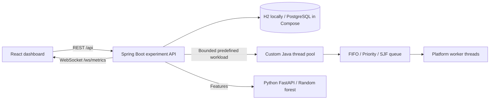

# Architecture and concurrency contract

The experiment coordinator is separate from the custom worker pool. Starting a run returns HTTP 202 immediately. The coordinator submits a seeded batch and drains the pool. The engine admits a single experiment at a time; the HTTP server and metrics timer remain responsive while workers run.

## Synchronization

All queue mutations, policy selection, submission admission and worker lifecycle flags use the pool monitor. A worker waits with the monitor released, removes exactly one task while holding the monitor, then executes outside it. Queue capacity is bounded and submissions fail explicitly on overflow or after shutdown. Atomic counters and synchronized timing lists protect observations.

FIFO uses sequence numbers. Priority compares descending priority then sequence. SJF compares estimated duration then sequence. When any queued task is at least two seconds old, selection uses FIFO so repeated short/high-priority arrivals cannot indefinitely bypass old queued work. This is a non-preemptive policy; aging cannot interrupt a running task.

Resize marks excess workers to retire between tasks. Growth starts platform threads; growth is rejected if retiring workers would cause the physical count to exceed 32. Graceful shutdown stops accepting and drains the queue. Cancellation discards queued work and interrupts cooperative predefined tasks. Task failures are recorded and workers continue. No arbitrary submitted source code executes.

## Observation and persistence

Task wait and response times use System.nanoTime. Throughput uses completed work per coordinator elapsed time. Process CPU utilization is the delta of JVM process CPU time divided by elapsed time and available processors; it includes API/GC/metrics overhead and returns -1 when unsupported. Worker utilization sums task execution time divided by elapsed time and configured worker count. Queue-selection overhead measures the selection operation, excluding time waiting to acquire the monitor. Live observations can briefly span different counter updates; final observations are collected after workers terminate.

Experiment payloads are persisted at creation and terminal state. Current live observations come from memory. On restart, persisted RUNNING entries are marked INTERRUPTED. H2 and PostgreSQL use the same small JDBC schema. The model is loaded once at advisor startup and requires a restart after retraining.

## Boundaries

The optimizer recommends the next run's policy and count. It never manipulates Java threads directly. Automatic adaptive resizing with cooldown and hysteresis is future work. The dashboard cannot execute arbitrary Java, Python or shell commands. Public deployment still needs hosting configuration and should protect a shared academic demonstration with reverse-proxy authentication.
